<div align="center">

<!-- ======================================================== -->
<!-- 00 // HERO BANNER & IDENTITY                              -->
<!-- ======================================================== -->

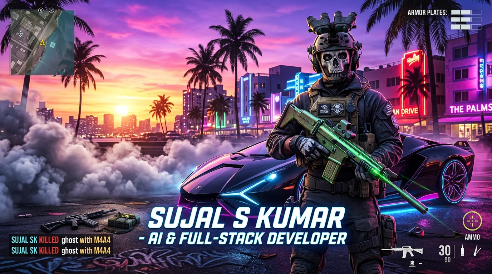

<br/><br/>

<!-- ======================================================== -->
<!-- SAMURAI TYPING TERMINAL & STATUS BADGES                  -->
<!-- ======================================================== -->

<a href="https://github.com/sujal05091">
  
</a>

<br/><br/>


<br/><br/>

<p align="center">
  <a href="https://github.com/sujal05091">
    
  </a>
</p>

<br/><br/>


<br/><br/>

<!-- ======================================================== -->
<!-- 01 // OPERATIVE DOSSIER // TASK FORCE 141                                    -->
<!-- ======================================================== -->

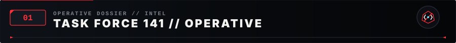

<br/><br/>

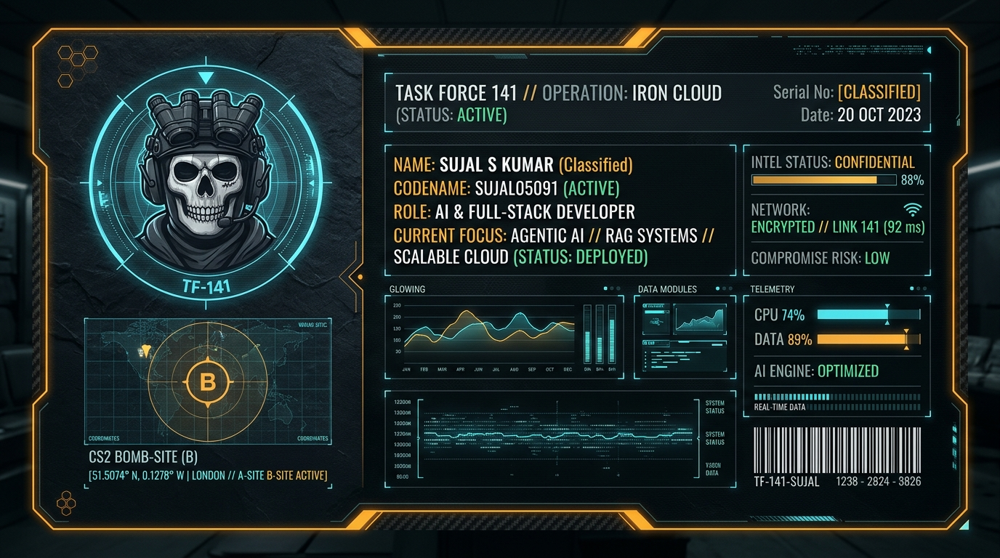

<br/><br/>

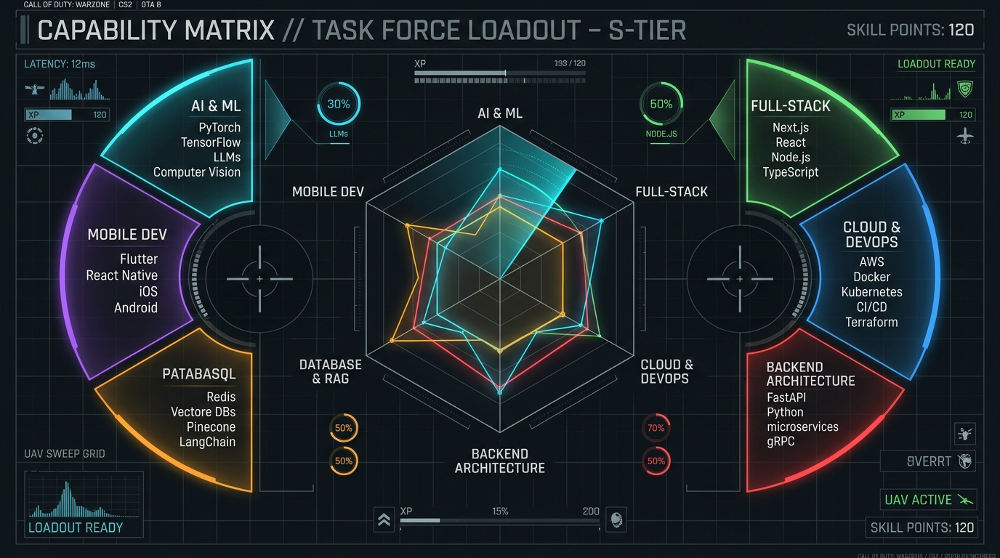

</div>

<br/><br/>

<div align="center">


<br/><br/>

<!-- ======================================================== -->
<!-- 02 // TECH ARSENAL                                       -->
<!-- ======================================================== -->

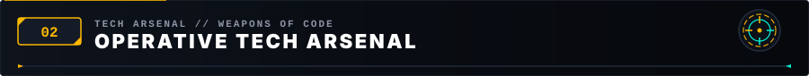

</div>

<p align="left"><em>A curated inventory of the languages, frameworks, and tools deployed across missions:</em></p>

### Programming Languages

<p align="left">
  
</p>

### AI & Machine Learning

<p align="left">
  
</p>

### Frontend Engineering

<p align="left">
  
</p>

### Backend & APIs

<p align="left">
  
</p>

### Mobile Engineering

<p align="left">
  
</p>

### Databases, Cloud & Vector Stores

<p align="left">
  
</p>

### Tools & DevOps

<p align="left">
  
</p>

<div align="center">

<br/><br/>


<br/><br/>

<!-- ======================================================== -->
<!-- 03 // HEIST ARCHIVES // MISSION DATABASE                 -->
<!-- ======================================================== -->

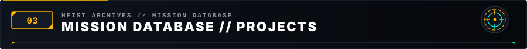

</div>

<br/>

<table width="100%">
  <tr>
    <td width="50%" valign="top">
      <h4>⚡ <a href="https://github.com/sujal05091/B2B-SmartMarketing-SaaS" target="_blank">B2B Smart Marketing SaaS</a> // Autonomous Lead &amp; Outreach Engine</h4>
      <p>Full-stack AI-powered B2B marketing SaaS platform automating business lead discovery, verified email identification, and personalized LLM cold outreach with task tracking.</p>
      <ul>
        <li><strong>Focus:</strong> Lead discovery, email extraction, LLM outreach &amp; centralized CRM telemetry</li>
        <li><strong>Stack:</strong> <code>Python</code> <code>FastAPI</code> <code>Next.js</code> <code>TypeScript</code> <code>MongoDB Atlas</code> <code>OpenAI</code> <code>Ollama</code> <code>JWT</code></li>
        <li><strong>Repository:</strong> <a href="https://github.com/sujal05091/B2B-SmartMarketing-SaaS" target="_blank"><code>sujal05091/B2B-SmartMarketing-SaaS</code></a></li>
      </ul>
    </td>
    <td width="50%" valign="top">
      <h4>🩺 <a href="https://github.com/sujal05091/adhesion-detection" target="_blank">Adhesion AI</a> // Post-Surgery Adhesion Detection</h4>
      <p>AI-driven healthcare diagnostic suite analyzing surgical medical images &amp; video streams to detect internal tissue adhesions, rendering diagnostic confidence &amp; reports.</p>
      <ul>
        <li><strong>Focus:</strong> Surgical video analysis, computer vision prediction &amp; clinical reporting</li>
        <li><strong>Stack:</strong> <code>Python</code> <code>TensorFlow</code> <code>OpenCV</code> <code>Flutter</code> <code>Android</code> <code>Firebase</code></li>
        <li><strong>Repository:</strong> <a href="https://github.com/sujal05091/adhesion-detection" target="_blank"><code>sujal05091/adhesion-detection</code></a></li>
      </ul>
    </td>
  </tr>
  <tr>
    <td width="50%" valign="top">
      <h4>🏦 <a href="https://github.com/sujal05091/drifting-oracle-analyser" target="_blank">Drifting Oracle</a> // AI Loan Decision &amp; Drift Radar</h4>
      <p>Intelligent credit decisioning platform incorporating Population Stability Index (PSI) drift monitoring to detect shifting input data distributions with LLaMA explainability.</p>
      <ul>
        <li><strong>Focus:</strong> ML loan evaluation, real-time data drift telemetry &amp; explainable AI (XAI)</li>
        <li><strong>Stack:</strong> <code>Databricks</code> <code>MLflow</code> <code>Delta Lake</code> <code>Gradio</code> <code>LLaMA</code> <code>Scikit-learn</code></li>
        <li><strong>Repository:</strong> <a href="https://github.com/sujal05091/drifting-oracle-analyser" target="_blank"><code>sujal05091/drifting-oracle-analyser</code></a></li>
      </ul>
    </td>
    <td width="50%" valign="top">
      <h4>🎓 <a href="https://github.com/sujal05091/ai-placement-predictor" target="_blank">AI Placement Predictor</a> // Career &amp; Readiness Platform</h4>
      <p>AI analytics platform extracting student resume PDFs, calculating placement probability via XGBoost, explaining feature weightings with SHAP, and offering Gemini AI career coaching.</p>
      <ul>
        <li><strong>Focus:</strong> Resume parsing, SHAP feature explainability &amp; autonomous career guidance</li>
        <li><strong>Stack:</strong> <code>React</code> <code>Vite</code> <code>Flask</code> <code>Python</code> <code>XGBoost</code> <code>SHAP</code> <code>Google Gemini</code> <code>Docker</code></li>
        <li><strong>Repository:</strong> <a href="https://github.com/sujal05091/ai-placement-predictor" target="_blank"><code>sujal05091/ai-placement-predictor</code></a></li>
      </ul>
    </td>
  </tr>
  <tr>
    <td width="50%" valign="top">
      <h4>🚗 <a href="https://github.com/sujal05091/saferoad-ai" target="_blank">SafeRoadAI</a> // Dual-Camera Road Safety Assistant</h4>
      <p>Edge AI Android application utilizing on-device computer vision to monitor driver drowsiness, road hazards, and traffic signs in real time with millisecond alert responses.</p>
      <ul>
        <li><strong>Focus:</strong> Driver alertness tracking, edge AI inference &amp; collision prevention telemetry</li>
        <li><strong>Stack:</strong> <code>Kotlin</code> <code>TensorFlow Lite</code> <code>ML Kit</code> <code>Android</code> <code>CameraX</code> <code>Firebase</code></li>
        <li><strong>Repository:</strong> <a href="https://github.com/sujal05091/saferoad-ai" target="_blank"><code>sujal05091/saferoad-ai</code></a></li>
      </ul>
    </td>
    <td width="50%" valign="top">
      <h4>🎭 <a href="https://github.com/sujal05091/deepfake-detection" target="_blank">Deepfake Detection</a> // Synthetic Media Authenticity Radar</h4>
      <p>Deep learning cybersecurity system identifying manipulated facial media and synthetic video artifacts with temporal consistency analysis and forgery score visualization.</p>
      <ul>
        <li><strong>Focus:</strong> Deepfake video forensics, facial artifact inspection &amp; synthetic media defense</li>
        <li><strong>Stack:</strong> <code>Python</code> <code>PyTorch</code> <code>TensorFlow</code> <code>OpenCV</code> <code>CNN</code> <code>Cybersecurity AI</code></li>
        <li><strong>Repository:</strong> <a href="https://github.com/sujal05091/deepfake-detection" target="_blank"><code>sujal05091/deepfake-detection</code></a></li>
      </ul>
    </td>
  </tr>
  <tr>
    <td width="50%" valign="top">
      <h4>🛡️ <a href="https://github.com/sujal05091/axiom-cyber-security" target="_blank">Axiom Security &amp; PhishGuard</a> // Android Cyber Shield</h4>
      <p>Comprehensive Android security platform featuring phishing link heuristic analysis, OCR image inspection, suspicious QR detection, and biometric threat defense.</p>
      <ul>
        <li><strong>Focus:</strong> Automated threat scoring, on-device OCR, biometric locks &amp; emergency SOS</li>
        <li><strong>Stack:</strong> <code>Kotlin</code> <code>Jetpack Compose</code> <code>MVVM</code> <code>Room</code> <code>ML Kit</code> <code>Biometric API</code></li>
        <li><strong>Repository:</strong> <a href="https://github.com/sujal05091/axiom-cyber-security" target="_blank"><code>sujal05091/axiom-cyber-security</code></a></li>
      </ul>
    </td>
    <td width="50%" valign="top">
      <h4>🍲 <a href="https://github.com/sujal05091/anwika-chicken-center" target="_blank">Home Harvest</a> // Food &amp; Tiffin Delivery Platform</h4>
      <p>Full-stack mobile ecosystem digitizing home-cooked meals by connecting customers with home kitchens, sellers, and delivery riders with live tracking and media integration.</p>
      <ul>
        <li><strong>Focus:</strong> Role-based access (Customer/Cook/Rider), live order pipeline &amp; media CDN</li>
        <li><strong>Stack:</strong> <code>Flutter</code> <code>Dart</code> <code>Firebase</code> <code>Cloudinary</code> <code>RESTful APIs</code></li>
        <li><strong>Repository:</strong> <a href="https://github.com/sujal05091/anwika-chicken-center" target="_blank"><code>sujal05091/Home-Harvest</code></a></li>
      </ul>
    </td>
  </tr>
  <tr>
    <td width="50%" valign="top">
      <h4>🚨 <a href="https://github.com/sujal05091/suraksha-ai" target="_blank">Suraksha AI / MCP Women Safety</a> // Emergency Defense System</h4>
      <p>Autonomous AI-agent women safety platform with multi-channel emergency triggers, live GPS mesh telemetry, audio forensic recording, and offline emergency dispatch.</p>
      <ul>
        <li><strong>Focus:</strong> Panic telemetry, silent gesture triggers, secure location mesh &amp; rescue dashboard</li>
        <li><strong>Stack:</strong> <code>Dart</code> <code>Flutter</code> <code>Python</code> <code>WebSockets</code> <code>IoT Sensors</code> <code>Firebase</code></li>
        <li><strong>Repository:</strong> <a href="https://github.com/sujal05091/suraksha-ai" target="_blank"><code>sujal05091/suraksha-ai</code></a></li>
      </ul>
    </td>
    <td width="50%" valign="top">
      <h4>🌾 <a href="https://github.com/sujal05091/AgriMind-Smart-Agriculture-Suite" target="_blank">AgriMind / Plant Guard</a> // Smart Farm IoT Ecosystem</h4>
      <p>IoT agricultural monitoring system combining soil sensor nodes, environmental telemetry, and automated security mechanisms to safeguard farm yields and detect crop anomalies.</p>
      <ul>
        <li><strong>Focus:</strong> Soil moisture/temp telemetry, intrusion alert siren &amp; automated farm monitoring</li>
        <li><strong>Stack:</strong> <code>Dart</code> <code>Flutter</code> <code>ESP32</code> <code>IoT Sensors</code> <code>Firebase</code> <code>Cloud Firestore</code></li>
        <li><strong>Repository:</strong> <a href="https://github.com/sujal05091/AgriMind-Smart-Agriculture-Suite" target="_blank"><code>sujal05091/AgriMind-Smart-Agriculture-Suite</code></a></li>
      </ul>
    </td>
  </tr>
</table>

<br/><br/>

<div align="center">


<br/><br/>

<!-- ======================================================== -->
<!-- 04 // COMMIT RADAR // CODE CADENCE                       -->
<!-- ======================================================== -->

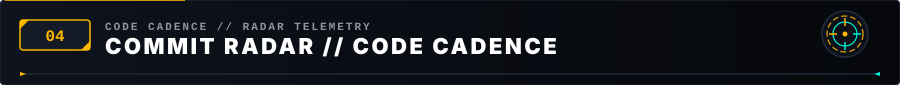

<br/><br/>


<br/><br/>


<br/><br/>

<!-- ======================================================== -->
<!-- 05 // COMBAT PATROL // 52-WEEK ACTIVITY               -->
<!-- ======================================================== -->

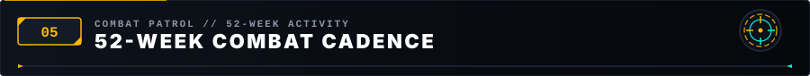

<br/><br/>


<br/><br/>


<br/><br/>


<br/><br/>

<!-- ======================================================== -->
<!-- 06 // 2026 MISSION DIRECTIVES // ROADMAP                 -->
<!-- ======================================================== -->

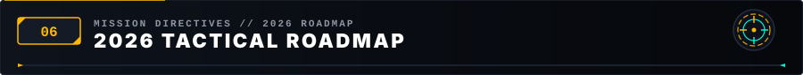

</div>

<br/>

<p><em>Operative milestones scheduled across the 2026 tactical deployment roadmap:</em></p>

- [x] 🚀 **Initialize Ronin Telemetry HUD**: Deploy interactive mainframe profile &amp; real-time analytics.
- [x] 🏆 **IEEE YESIST12 2026 Selection**: Advance to the global finals in Jakarta, Indonesia.
- [x] 🥈 **National Hackathon Podium**: Secure 2nd Runner Up at MIT Mysore &amp; HackMitten 2.0.
- [ ] 🤖 **Deploy End-to-End Agentic SaaS**: Architect and scale a multi-tenant applied AI product with RAG &amp; vector search.
- [ ] 📱 **Ship 5 Production Mobile Solutions**: Deploy resilient Flutter/Kotlin apps on Google Play Store.
- [ ] 📈 **1,000+ Sustained Contributions**: Maintain consistent open-source engineering cadence and commits across repositories.
- [ ] 🌐 **Full-Stack Dubai Real Estate Platform**: Complete end-to-end full-stack feature delivery at Accolade Tech Solutions.

<br/>

<div align="center">


<br/><br/>

<!-- ======================================================== -->
<!-- 07 // TROPHY ROOM // SAMURAI ACCOLADES                   -->
<!-- ======================================================== -->

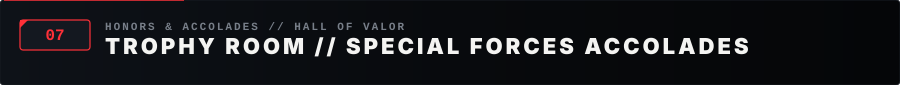

<br/><br/>

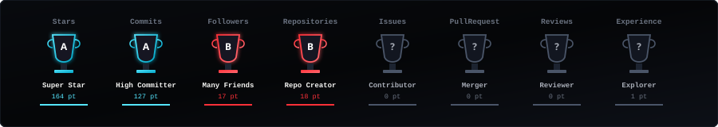

<br/><br/>

<!-- ======================================================== -->
<!-- ACHIEVEMENTS & CERTIFICATIONS VAULT                      -->
<!-- ======================================================== -->

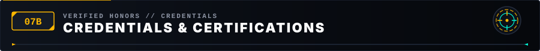

<br/><br/>

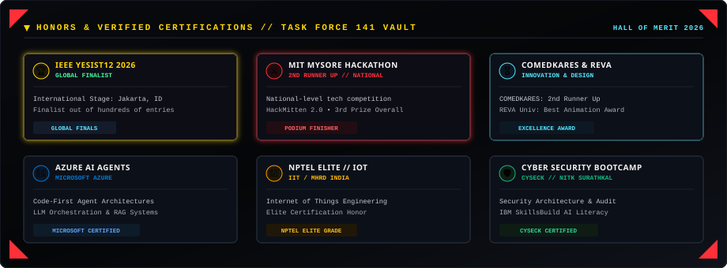

<br/><br/>

<table align="center" border="0" cellspacing="0" cellpadding="0">
  <tr>
    <td align="center" valign="middle">
      
    </td>
    <td width="20"></td>
    <td align="center" valign="middle">
      
    </td>
    <td width="20"></td>
    <td align="center" valign="middle">
      
    </td>
    <td width="20"></td>
    <td align="center" valign="middle">
      
    </td>
  </tr>
</table>

<br/><br/>


<br/><br/>

<!-- ======================================================== -->
<!-- 08 // WARZONE TELEMETRY // MAINFRAME METRICS               -->
<!-- ======================================================== -->

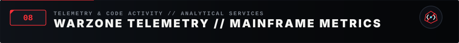

</div>

<br/>

<p align="left"><em>Telemetry and code activity monitored through GitHub's analytical services:</em></p>

<div align="center">

<br/>

<a href="https://github.com/sujal05091">
  
</a>

<br/><br/>


<br/><br/>

<p align="center">
  <a href="https://github.com/sujal05091" target="_blank">
    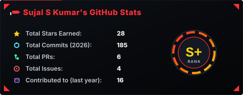
  </a>
  &nbsp;&nbsp;
  <a href="https://github.com/sujal05091" target="_blank">
    
  </a>
</p>

<br/><br/>


<br/><br/>

<!-- ======================================================== -->
<!-- 09 // SECURE COMMS // TASK FORCE CHANNELS                     -->
<!-- ======================================================== -->

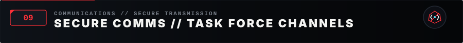

</div>

<br/>

<p align="left"><em>Connect across developer networks and platforms:</em></p>

<div align="center">

<br/>

<a href="https://github.com/sujal05091" target="_blank">
  
</a>
<a href="https://www.linkedin.com/in/sujal-s-kumar-53630a295" target="_blank">
  
</a>
<a href="mailto:sujaludupi@gmail.com" target="_blank">
  
</a>
<a href="https://sujalskumar.dev" target="_blank">
  
</a>
<a href="https://leetcode.com/u/sujal05091" target="_blank">
  
</a>

<br/><br/>


<br/><br/>

<!-- ======================================================== -->
<!-- 10 // COMMAND TERMINAL // TACTICAL SHELL                    -->
<!-- ======================================================== -->

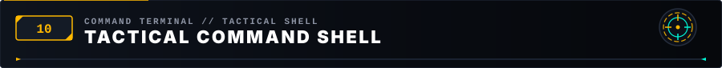

<br/><br/>


<br/><br/>

<!-- ======================================================== -->
<!-- FOOTER CREED TYPING TERMINAL                             -->
<!-- ======================================================== -->

<a href="https://github.com/sujal05091">
  
</a>

<br/><br/>

<!-- ======================================================== -->
<!-- MONOLITHIC TACTICAL FOOTER                                  -->
<!-- ======================================================== -->


<br/><br/>

```txt
[ TRANSMISSION END // SUJAL S KUMAR // TF-141 PROTOCOL 0x534B // ALL SYSTEMS ARMED ]
```

</div>
